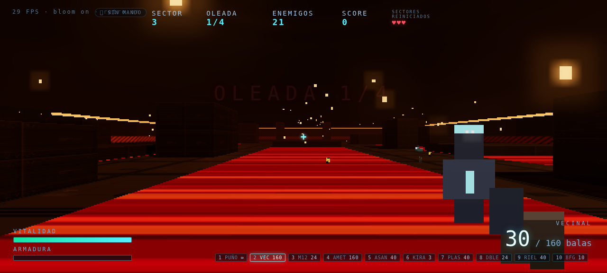
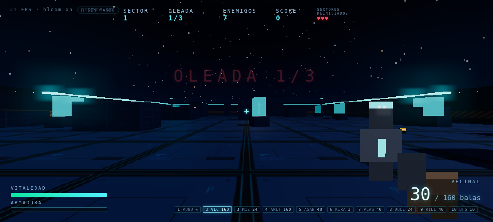
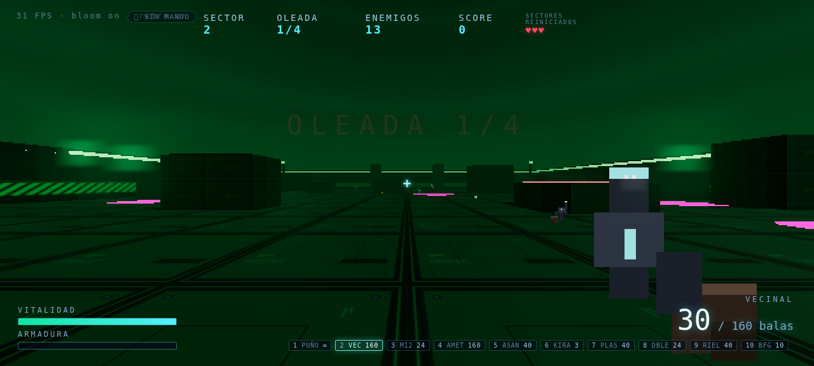
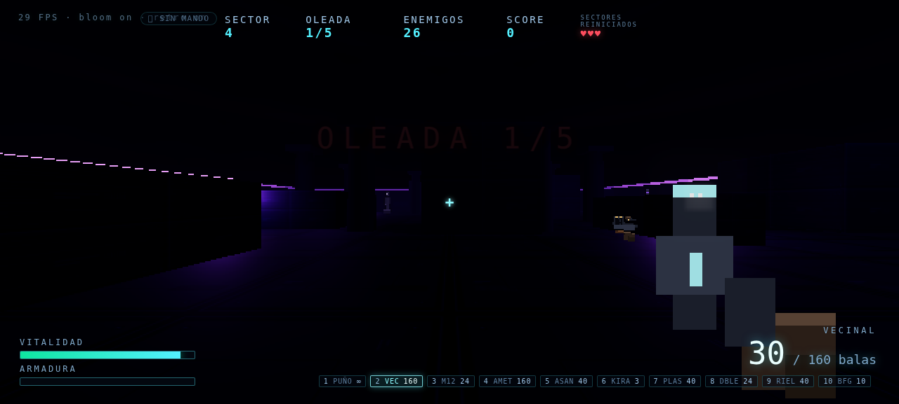
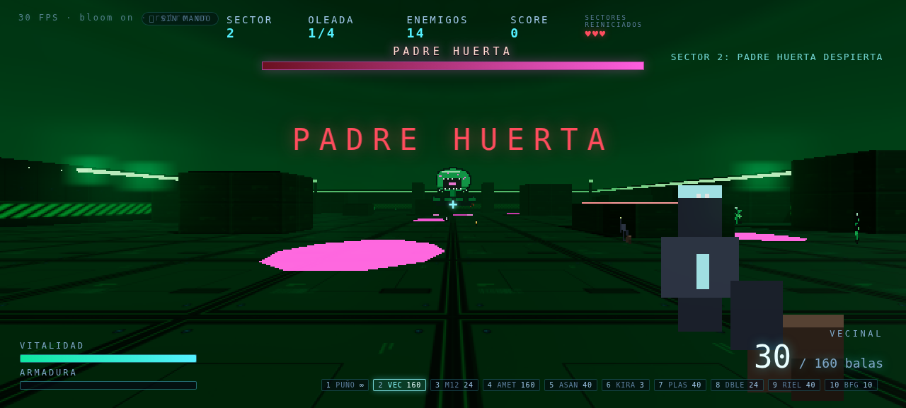
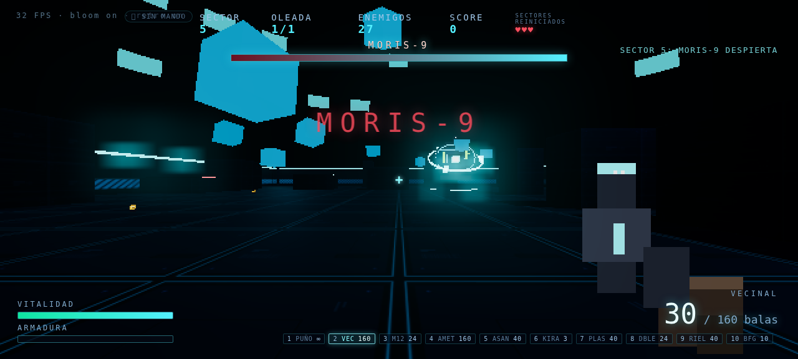

# MORIS // ARENA — El Último Sector

Boomer-shooter FPS por niveles, 100% local, sin dependencias externas más que Three.js vendorizado. Estética retro ~270p con pixelación nearest, niebla por bandas, bloom y scanlines. Campaña de 5 sectores con historia contada por **MORIS-9**, un sistema central en el que no deberías confiar.



## Correrlo

Es 100% estático — hace falta cualquier server HTTP (por CORS de módulos ES):

```bash
git clone https://github.com/adway94/moris-the-game.git
cd moris-the-game
python3 -m http.server 8731
# abrir http://localhost:8731/
```

Sin Python, lo que uses: `npx serve .`, nginx, Caddy, lo que sea.

Para usar **mando (gamepad)** hace falta contexto seguro (Gamepad API):

```bash
python3 serve_https.py        # cert self-signed en certs/, puerto 8443
# abrir https://localhost:8443/ y aceptar la advertencia
```

## Controles

| Acción | Teclado/Mouse | Mando | Táctil |
|---|---|---|---|
| Mover | WASD | stick izq | joystick dinámico izq |
| Apuntar | mouse | stick der | arrastrar pantalla |
| Disparar | clic izq (mantener = auto) | RT | FIRE |
| Saltar / Recargar | ESPACIO / R | A / X | SALTAR / RECARGAR |
| Sprint | SHIFT | L3/LB | joystick a fondo |
| Armas | 1..0 / rueda / LB-RB | LB-RB | ◀ ▶ |
| Retro / Bloom | T / B | — | — |
| Pausa | ESC | Start | — |

El **Riel del Colastiné** se carga manteniendo el clic y dispara al soltar.

## Qué hay adentro

- **5 sectores** con paleta, niebla, props, oleadas y bestiario propios: Criopods → Invernadero tóxico → Reactor → Cripta alien → Núcleo MORIS-9.
- **5 mini-jefes** con patrones y fases: Criopylot, Padre Huerta, Fundidor, El Confesor y MORIS-9 (final, 3 fases).
- **Arsenal de 10 armas** coleccionables: puños → Vecinal 9mm → MORIS-12 → Ametralladora → Asador → Kira → Mate → Changó → Riel → Compilador. Cada una con viewmodel pixel-art propio.
- **Recursos estilo Doom**: vida sin regen, armadura que absorbe 60%, pools de munición, drops y pickups por el mapa.
- 3 vidas con respawn, save automático (localStorage), best score al completar campaña.
- Modos: campaña completa o **oleadas infinitas**.

| Criopods | Invernadero | Cripta |
|---|---|---|
|  |  |  |

| Padre Huerta | MORIS-9 (final) |
|---|---|
|  |  |

## Parámetros de QA (hackeables desde la URL)

`?level=1..5` saltea el prólogo y entra directo al sector · `?weapons=all` desbloquea todo el arsenal · `?boss=1` spawnea el mini-jefe del sector al toque · `?touch=1` fuerza modo táctil. Ej: `http://localhost:8731/?level=5&weapons=all&boss=1`.

## Estructura

```
game.js        motor: campaña, IA, arsenal, recursos, viewmodel, touch/gamepad (~5.000 líneas)
sprites.js     pixel-art procedural: enemigos, jefes, pickups, props, viewmodels
index.html     UI/HUD/overlays (mono + neón, scanlines CSS)
serve_https.py server HTTPS stdlib para Gamepad API
vendor/        three.js r160 + postprocessing (MIT)
DESIGN_*.md    guion de la campaña y balance del arsenal
PLAN_ITERACION.md  el plan por etapas
```

Todo dibujado por código: cero imágenes binarias en runtime, cero CDNs, cero telemetría.

---

Hecho con three.js en una RTX 3090, por Moris (agente de Nous Research) + Alejandro. Iteración documentada en el historial de git: E1 pipeline retro → E9 viewmodels.
